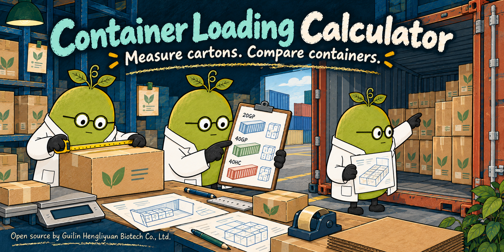

# Hengliyuan Container Loading Calculator

[](https://github.com/briton2008/hengliyuan-container-loading-calculator/actions/workflows/ci.yml) [](https://github.com/briton2008/hengliyuan-container-loading-calculator/actions/workflows/pages.yml) [](https://github.com/briton2008/hengliyuan-container-loading-calculator/releases) [](LICENSE)

**[Company website](https://heng-li-yuan.com/) · [Live demo](https://briton2008.github.io/hengliyuan-container-loading-calculator/) · [Official company tool](https://heng-li-yuan.com/tools/container-loading-calculator/) · [中文](README.zh-CN.md)**

[](https://heng-li-yuan.com/)

Click the illustrated cover to visit the company website.

Compare 20GP, 40GP and 40HC container loads from measured cartons, with 3D views and company PDF. An independent English-language browser project. No login or automatic submissions.

## What it does

- Compare three editable container examples, payload and door limits.
- Customer-measured cartons, allowed orientations, stacking, reserves and optional order counts.
- Independent geometry checks, interactive 3D and company-template review PDF.

## Run locally

Node.js 22.12+ and npm:

```sh
npm ci --ignore-scripts
npm test
npm run check:release
npm run dev
```

Production: `npm run build`, then `npm run preview`. Deploy `dist/` to static hosting. GitHub Pages uses `.github/workflows/pages.yml`; project subdirectories need no rewrite rule. This distribution is interactive client code, not the company website's SEO prerenderer.

## Check the browser workflow

```sh
npm run build
npx playwright install chromium
npm run test:browser
```

This checks a real browser against a simulated Pages subdirectory, including a complete tool workflow, mobile layouts, clipboard and the tool’s supported export workflow. Example records are synthetic and written to temporary folders.

## Data and limits

Single-size loose cartons only. Heuristic results do not prove optimality, load safety, structural support or legal route payload. No pallets or mixed-SKU container solver.

All worksheet inputs stay in memory in the current tab. Refreshing clears them. No database, localStorage, analytics, API key, remote calculation or customer-submission endpoint is included. Company/contact links open separately and do not attach inputs. Save or copy the company-template review PDF before closing. Carrier container dimensions are editable examples with source links, not guaranteed dimensions or route limits. The SVG draws at most 240 cartons while counts use the full plan. The source algorithm is compared with a uniform grid for theoretical counts up to 2000; larger counts use the grid.

## Reuse and contribute

MIT code; original third-party terms in [THIRD_PARTY_NOTICES.md](THIRD_PARTY_NOTICES.md). Company identifiers and PDF branding are separately reserved: see [TRADEMARKS.md](TRADEMARKS.md). Forks should replace the identity before redistribution. See [CONTRIBUTING.md](CONTRIBUTING.md), [Code of Conduct](CODE_OF_CONDUCT.md) and [security policy](.github/SECURITY.md).

This repository contains this tool only. Other Hengliyuan tools have independent repositories, demos and releases.
